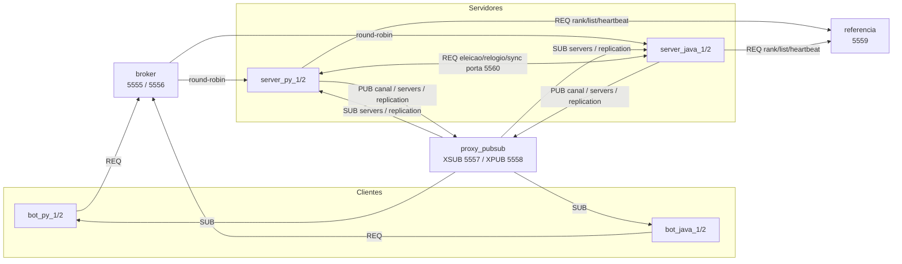
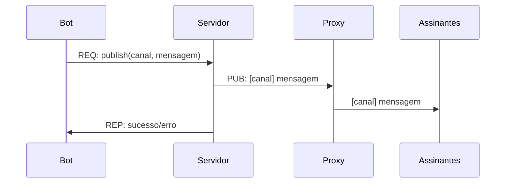

# Sistema distribuído de troca de mensagens (BBS/IRC simplificado)

Projeto da disciplina de Sistemas Distribuídos. É uma versão simplificada de um sistema estilo BBS/IRC: **bots** (clientes) fazem login, criam e assinam **canais públicos** e publicam mensagens. **Servidores** guardam tudo em disco, se coordenam entre si (relógios, eleição) e **replicam** os dados para que todos tenham o histórico completo.

Tudo roda em containers, orquestrado pelo Docker Compose, e nenhuma parte depende de interação humana: os usuários são bots.

## Como executar

```bash
docker compose up --build
```

Sobem automaticamente: broker, proxy Pub/Sub, serviço de referência, 2 servidores Python, 2 servidores Java, 2 bots Python e 2 bots Java. Cada container imprime no terminal toda mensagem enviada ou recebida (com timestamp e relógio lógico `LC`).

Os dados de cada servidor ficam em `./data/<nome_do_servidor>/database.json` (volume separado por servidor, nada é compartilhado em disco).

Para parar: `docker compose down`. Para testar tolerância a falhas, derrube um servidor com `docker stop server_py_1` e observe a eleição/replicação nos logs dos demais; `docker start server_py_1` o reintegra.

## Estrutura do repositório

```
.
├── docker-compose.yaml
├── broker/          # Req-Rep: balanceador round-robin (clientes 5555 <-> servidores 5556)
├── proxy_pubsub/    # Pub-Sub: XSUB 5557 <-> XPUB 5558
├── referencia/      # serviço de referência (rank, lista de servidores, heartbeat)
├── python/          # server.py e client.py
└── java/            # ServerMain.java e ClientBotMain.java
```

> Preencher aqui a linguagem usada no `broker` e no `proxy_pubsub`.

## Escolhas de projeto

| Item | Escolha |
|---|---|
| Troca de mensagens | ZeroMQ (REQ/REP, PUB/SUB, ROUTER/DEALER, XSUB/XPUB) |
| Linguagens | Python e Java (servidor e cliente completos em cada uma, interoperáveis) |
| Serialização | MessagePack (binário) em **todas** as mensagens |
| Persistência | Arquivo `database.json` por servidor |
| Orquestração | Docker Compose, rede `bbs_net` (bridge) |

**Por que MessagePack?** É um formato binário conhecido, tem biblioteca madura em Python (`msgpack`) e Java (`jackson-dataformat-msgpack`) e mantém a estrutura de dicionário, o que facilita manter o mesmo formato nas duas linguagens.

**Por que JSON no disco?** A restrição de não usar JSON vale para as mensagens trocadas na rede. No disco o formato é livre e o JSON facilita inspecionar os dados.

## Arquitetura



- **Broker**: distribui as requisições dos bots entre os servidores em round-robin. Por isso cada servidor recebe só uma parte das requisições, o que motiva a replicação (Parte 5).
- **Proxy Pub/Sub**: ponto único de encontro entre publicadores (servidores) e assinantes (bots e servidores).
- **Referência**: dá o rank de cada servidor, mantém a lista de servidores ativos e remove quem para de enviar heartbeat.
- **Servidores**: tratam os pedidos dos bots, publicam nos canais, persistem, replicam, elegem coordenador e sincronizam relógio.
- **Bots**: seguem um comportamento padronizado (ver Parte 2).

## Formato das mensagens

Todas as mensagens são mapas MessagePack e carregam `timestamp` (hora de envio) e `logical_clock` (contador do remetente).

**Cliente ↔ Servidor** (via broker):

```
requisição: {"service": s, "data": {..., "timestamp": t}, "logical_clock": n}
resposta:   {"service": s, "data": {"status": "sucesso"|"erro", "timestamp": t,
                                    "description": "..."}, "logical_clock": n}
```

| `service` | `data` na requisição | Resposta |
|---|---|---|
| `login` | `user` | `status` |
| `channel` | `channel` | `status` (+ `description` em erro) |
| `channels` | nada | `channels`: lista de nomes |
| `publish` | `channel`, `message`, `user` | `status` (+ `description` em erro) |

**Erros tratados:** nome de usuário vazio; nome de canal vazio ou com espaço; canal duplicado; publicação em canal inexistente; mensagem vazia; serviço desconhecido. Em caso de erro no login, o bot tenta novamente.

**Publicação (Pub/Sub):** frame 1 = nome do canal (tópico), frame 2 = `{"channel", "message", "user", "timestamp", "logical_clock"}`.

**Servidor ↔ Referência** (porta 5559): `get_rank` (`name`) → `rank`; `list` → `servers: [{name, rank}]`; `heartbeat` (`name`) → `status`.

**Servidor ↔ Servidor** (porta 5560 de cada servidor): `eleicao` → `OK`; `relogio` → `OK` + `time`; `sync` (`vector`) → `OK` + `ops`.

**Tópico `servers`:** `{"coordinator": nome, "timestamp", "logical_clock"}`.

## Parte 1: Login e canais

O bot envia `login` e o servidor responde `sucesso` ou `erro`. Depois o bot lista canais (`channels`) e cria canais (`channel`). Cada servidor grava em disco todos os logins (com timestamp) e todos os canais criados.

## Parte 2: Publicação com Pub/Sub

O bot envia `publish` ao servidor; o servidor persiste a mensagem, publica no tópico com o nome do canal e responde `sucesso`/`erro`.



O assinante exibe canal, usuário, mensagem, timestamp de envio e timestamp de recebimento. **Somente o servidor que recebeu o pedido publica** para os bots; as réplicas apenas gravam, evitando mensagens duplicadas.

**Comportamento padronizado dos bots:**
1. Login ao iniciar.
2. Se existirem menos de 5 canais, cria um novo.
3. Se estiver inscrito em menos de 3 canais, assina um canal aleatório que ainda não assina.
4. Em loop infinito: escolhe um canal e envia 10 mensagens, com 1 s entre elas. Esse intervalo é usado para ouvir o proxy, então o bot continua recebendo mensagens enquanto espera.

## Parte 3: Relógios e heartbeat

**Relógio lógico (Lamport)**, em bots e servidores: o contador é incrementado antes de cada envio e vai na mensagem; ao receber, o processo faz `contador = max(contador, recebido)`.

**Serviço de referência:**
- `get_rank`: devolve o rank do servidor (sequencial, sem repetir nomes). Um servidor que volta mantém o mesmo rank.
- `list`: devolve nome e rank dos servidores ativos.
- `heartbeat`: cada servidor envia um a cada **10 mensagens de clientes** recebidas. Quem fica mais de 60 s sem enviar é removido da lista. Se um servidor removido voltar a enviar heartbeat, é registrado de novo.

## Parte 4: Eleição e sincronização do relógio

- **Eleição (algoritmo do valentão):** o servidor consulta a lista na referência e envia `eleicao` aos de rank maior. Se algum responde `OK`, ele aguarda o anúncio do vencedor. Se ninguém responde, ele se declara coordenador e publica seu nome no tópico `servers`. Quem recebe um pedido de eleição responde `OK` e começa a sua própria eleição.
- **Variável do coordenador:** cada servidor mantém `coordinator_name`, atualizado pelo tópico `servers`.
- **Relógio:** a cada **15 mensagens de clientes** o servidor pede a hora ao coordenador (`relogio`) e ajusta seu deslocamento (`offset`) compensando metade do RTT. Se o coordenador não responde, o servidor dispara uma nova eleição.
- A referência **não** devolve mais a hora no heartbeat.

> Observação: o enunciado pede o algoritmo de Berkeley com o padrão REQ relógio / REP hora correta. A implementação segue esse padrão de mensagens, com o coordenador como referência de tempo e compensação do RTT (o que se aproxima do algoritmo de Cristian). Na versão original de Berkeley, o coordenador consulta todos os servidores e distribui a média.

## Parte 5: Consistência e replicação

**Método escolhido:** replicação baseada em **log de operações com vetor de versões**, com difusão por Pub/Sub e **anti-entropia** (reconciliação periódica). Todos os servidores aceitam escritas (modelo *multi-master*) e convergem para o mesmo conjunto de dados (**consistência eventual**).

**Como funciona:**
1. Toda escrita (login, canal, mensagem) vira uma **operação** `{type, origin, seq, data}`, onde `origin` é o servidor que a recebeu e `seq` é um contador crescente por origem.
2. A operação é aplicada localmente, anexada ao **log** e persistida em disco.
3. O servidor publica a operação no tópico `replication`. Os demais assinam o tópico e aplicam a operação.
4. Cada servidor mantém um **vetor** `origem → última seq aplicada`. Uma operação só é aplicada se `seq == última + 1` (garante ordem por origem). Se `seq <= última` é duplicada e é ignorada. Se há buraco, o servidor dispara uma sincronização.
5. **Sincronização** (`sync`, porta 5560): o servidor envia seu vetor e o par devolve as operações que faltam. Isso acontece quando:
   - um servidor **novo ou reiniciado** inicia (busca o histórico completo nos outros);
   - é detectado um **buraco** na sequência;
   - periodicamente, junto do heartbeat, com um servidor aleatório (**anti-entropia**), o que recupera operações perdidas pelo Pub/Sub (o ZeroMQ não garante entrega para assinantes que ainda não conectaram).
6. Como o log de cada servidor contém as operações de **todas** as origens, um servidor pode devolver operações de outro que já caiu.

**Adaptações feitas ao método:**
- Canais são tratados como conjunto (aplicar duas vezes não duplica), então criações simultâneas do mesmo canal em servidores diferentes convergem.
- A replicação usa o próprio proxy Pub/Sub do projeto, em vez de conexões diretas entre todos os servidores.
- A ordem entre operações de origens diferentes pode variar entre servidores. O conjunto final de dados é o mesmo, e cada operação carrega `timestamp` e `logical_clock` para permitir ordenar o histórico.

## Persistência

Cada servidor escreve em `/data/database.json` (montado em `./data/<servidor>`):

```json
{
  "logins":   [{"user", "timestamp", "origin"}],
  "channels": ["geral", "jogos"],
  "messages": [{"channel", "message", "user", "request_timestamp", "timestamp", "origin"}],
  "replication": {"seq": 0, "vector": {"server_py_1": 12}, "log": []}
}
```

## Portas

| Serviço | Porta |
|---|---|
| Broker (clientes / servidores) | 5555 / 5556 |
| Proxy Pub/Sub (XSUB / XPUB) | 5557 / 5558 |
| Serviço de referência | 5559 |
| Comunicação entre servidores | 5560 (interna de cada servidor) |